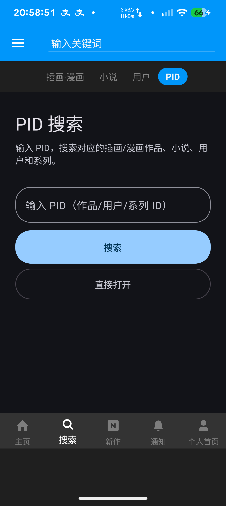
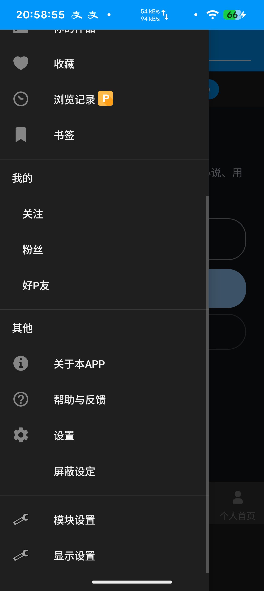
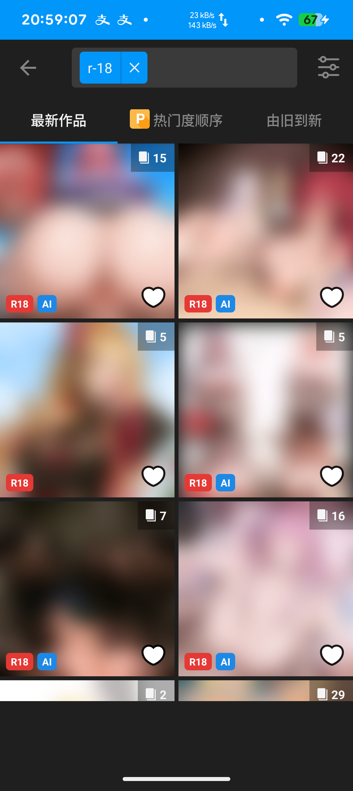
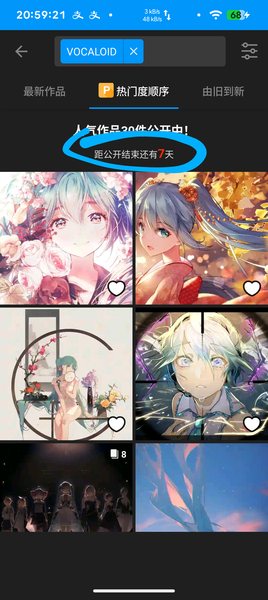
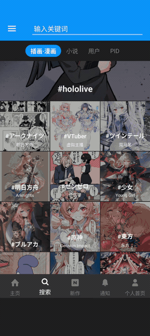
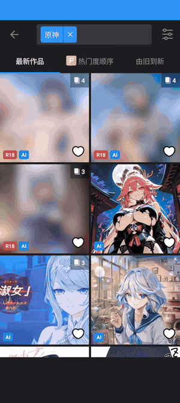
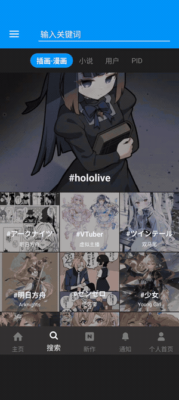

# PAuxiliary

[简体中文](README.md) | **English** | [日本語](README.ja.md)

PAuxiliary is an LSPosed helper module for [Pixiv](https://play.google.com/store/apps/details?id=jp.pxv.android) (jp.pxv.android).

> **Note**: This module is developed with Vibe Coding, so code quality varies. Use it at your own risk.

### Features

- **Unlimited popular-sort trial** — The 7-day trial for popularity-sorted search never expires. Premium accounts keep Pixiv's original behavior and are not affected by this hook.

- **PID search** — Adds a "PID" segment to the top bar of the main search page and opens a dedicated PID search page. Enter a PID and tap "Search" once to query illust/manga works, novels, users, manga series, and novel series at the same time. Results are shown as cards; tap a card to open its detail page. Work cards show preview images; user cards show the avatar, account, bio, illust/novel/following counts, and a Premium badge for premium accounts. A "Direct open" button lets you choose illust/manga, novel, user, manga series, or novel series from a dialog and jump directly. The search result page does not get an extra PID segment.

- **Cover badges** — Shows `R18`, `R18G`, and `AI` badges at the bottom-left of illust covers. Enabled by default; can be disabled in module settings.

- **R18/R18G blur** — Blurs R18/R18G illust covers and work detail previews. The blur radius is adjustable (5–50dp, default 24dp). Enabled by default; cover blur and detail blur can be disabled separately in module settings. Android 12+ uses `RenderEffect` for real-time blur; Android 11 and below falls back to reduced opacity plus a dark color filter.

- **Module settings** — Adds a "Module settings" entry to the sidebar and opens the module's own full-screen Compose Material 3 Expressive settings page with "Config" and "About" tabs:
  - Toggleable: cover badges, cover blur, detail preview blur
  - Adjustable: blur radius
  - Always on: PID search, module settings entry, work details dialog, trial/AB bypass

- **Trend tag long-press** — Long-press a trend tag on the search page to open an action menu: search the tag, open an example work, or view work info. A normal tap keeps the original search behavior.

- **M3E dialogs** — Off by default. When enabled, Pixiv's own title/message/button alerts and list menus are replaced with Material 3 Expressive dialogs; list menus use a bottom sheet. Restart Pixiv after changing the toggle. Dialogs with custom views, Spinners, and overflow menus remain native for now.

- **Work details** — Long-press a work → "View details" in the menu. The dialog shows the work title, author name, work PID, and user PID; the text can be long-pressed to copy.

- **Display settings** — Keeps the "Display settings" entry in the sidebar; tapping it opens the web-based browsing/display settings.

- **Localization** — Follows Pixiv's current language; includes English / Simplified Chinese / Japanese.

### Screenshots & demos

#### UI

<table>
<tr>
<td></td>
<td></td>
</tr>
<tr>
<td></td>
<td></td>
</tr>
</table>

#### GIF demos

**PID all-type search and direct open**



**M3E dialogs and work details**



**Trend tag long-press to open a work**



### How it works

| Feature | Hook target | Detection |
|---|---|---|
| Trial days | `e9b.q()` | DexKit: `86400000L` numeric search (the local preference key is not a DEX string) |
| AB test | `m83.a()` | DexKit: string `"] cannot be converted to a boolean."` |
| PID search | `SegmentedLayout` top bar on the main search page | Direct class name + DexKit fallback; hooks `setOnSelectSegmentListener`, appends a 4th segment and injects the PID page |
| All-type PID search | `app-api.pixiv.net` App API | Uses the host's `AccountManager` `net.pixiv` token to query illust/novel/user/series |
| Cover badges / cover blur | `ThumbnailView.d(ce7, boolean, Integer)`, ranking `d74.a()` | DexKit locates the bind method and work model; falls back to `toString` if field reads fail |
| Detail preview blur | `DetailImageViewHolder.bind`, `DetailUgoiraViewHolder.bind` | Direct class names; reads the work model's `xRestrict` and applies blur to the preview View |
| Trend tag long-press | Trend tag click callback on the search page | DexKit uses `"TrendTag(tag="` / `"SearchIllustAtTrendTag"` to locate the data class and callback; hooks `AbstractComposeView` to detect long presses |
| M3E dialogs | `ne.create()` / `oe.show()` | DexKit locates `ne`/`je`/`oe`; `create()` reads title, message, buttons, and items; `show()` replaces the native dialog with a Compose M3E dialog |
| Module settings | `MainActivity` sidebar | Finds `NavigationView`, adds a menu item, and opens a full-screen Compose Dialog |
| Display settings | `MainActivity` sidebar | Finds `NavigationView`, adds a menu item, and opens the web settings |
| View details | Dialog builder's `create()` | DexKit: `"layout_inflater"` → builder params class → `addInvoke` → builder → `create()` |

Named classes are preferred when available. For obfuscated classes, DexKit bytecode search is preferred, with a fallback to the 6.205.0 direct class/field names.

### Build

```bash
./gradlew assembleDebug
```

Requirements:

- `compileSdk 37.1` / `buildTools 37.0.0`
- AGP `9.5.3` / Gradle `9.8.2` / Kotlin `2.4.21`
- JDK 21
- Compose BOM `2026.11.01` / Material3 `1.5.0`

CI uses `assembleRelease` and uploads the uncompressed APK directly.

### Installation

1. Install the APK
2. Enable the module in LSPosed and select `jp.pxv.android` as the scope (or use the static scope)
3. Force stop Pixiv

### Supported versions

- Pixiv: developed and tested against **6.205.0**; DexKit is used when obfuscated classes/fields change
- Android: **9.0+** (API 28+); real GPU blur requires Android 12+ (API 31+)
- LSPosed API: **102**

### Third-party open source

- [libxposed](https://github.com/libxposed/api) — Apache-2.0
- [DexKit](https://github.com/LuckyPray/DexKit) — Apache-2.0 (`Core/` is LGPL-3.0)
- [AndroidHiddenApiBypass](https://github.com/LSPosed/AndroidHiddenApiBypass) — Apache-2.0
- AndroidX / Jetpack Compose / Material Components — Apache-2.0

See [THIRD_PARTY_NOTICES.md](THIRD_PARTY_NOTICES.md) for the full notices.

### License

[Apache-2.0](LICENSE)
