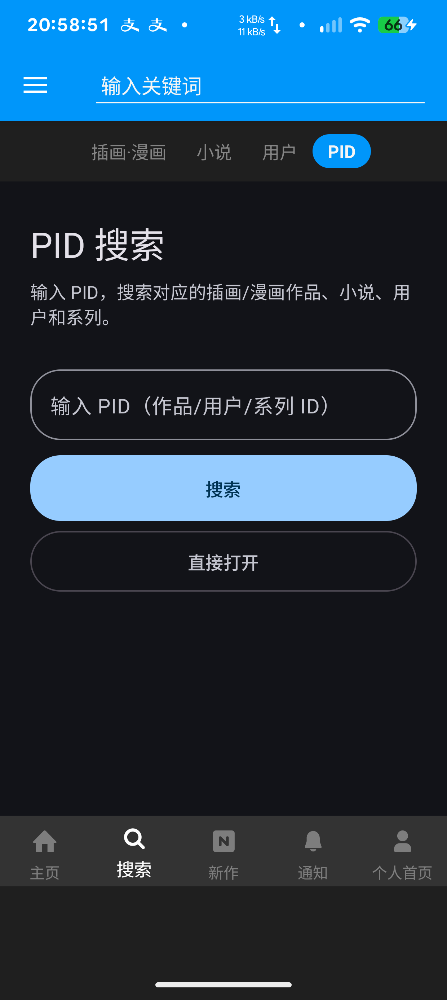
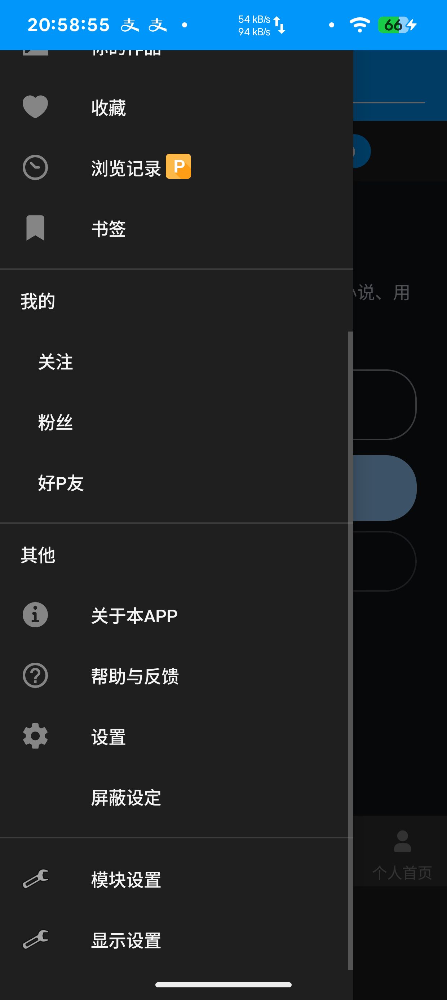
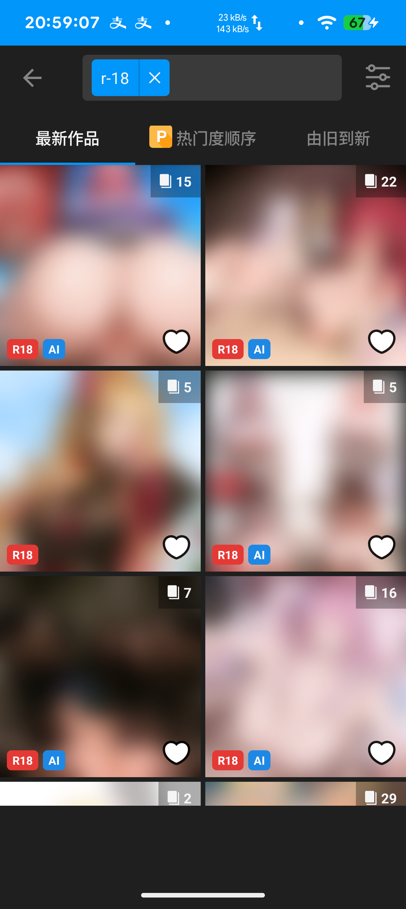
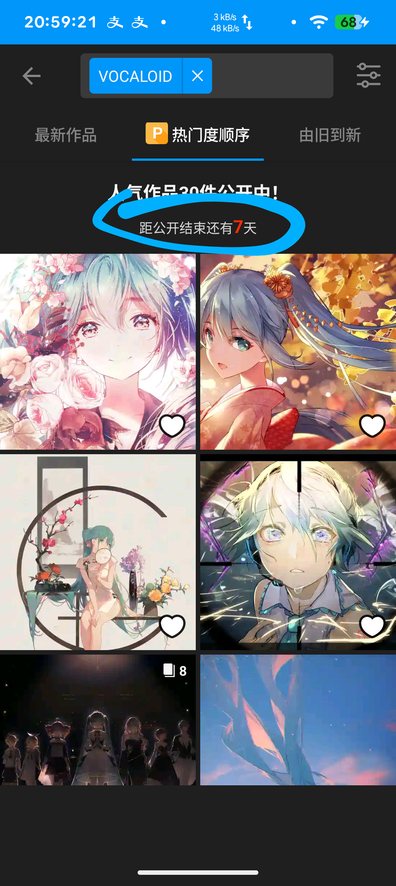
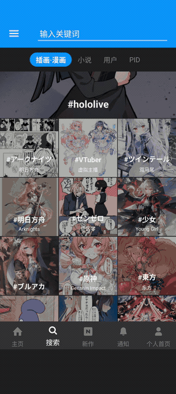
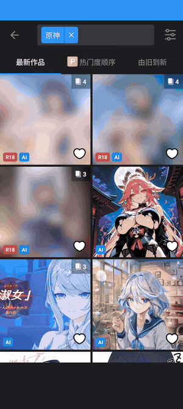
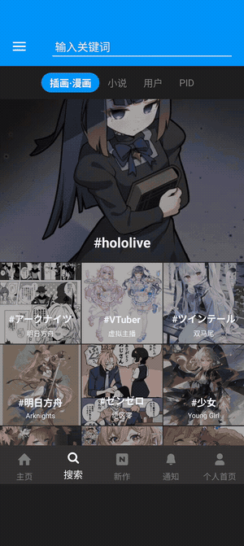

# PAuxiliary

[简体中文](README.md) | [English](README.en.md) | **日本語**

PAuxiliary は [Pixiv](https://play.google.com/store/apps/details?id=jp.pxv.android) (jp.pxv.android) 向けの LSPosed 補助モジュールです。

> **注意**：本モジュールは Vibe Coding で開発されているため、コード品質にはばらつきがあります。自己責任でご利用ください。

### 機能

- **人気順の無期限トライアル** — 人気順検索の 7 日間トライアルが期限切れになりません。プレミアムアカウントでは Pixiv 本来の動作を維持し、このフックの影響を受けません。

- **PID 検索** — メイン検索ページ上部に「PID」セグメントを追加し、専用の PID 検索ページを開きます。PID を入力して「検索」を一度押すと、イラスト/漫画作品、小説、ユーザー、漫画シリーズ、小説シリーズを同時に検索します。結果はカードで表示され、カードをタップすると対応する詳細ページを開きます。作品カードにはプレビュー画像、ユーザーカードにはアイコン、アカウント、自己紹介、作品数/小説数/フォロー数、プレミアムアカウントには Premium バッジを表示します。「直接開く」ボタンでは、イラスト/漫画、小説、ユーザー、漫画シリーズ、小説シリーズをダイアログで選択して直接ジャンプできます。検索結果ページには PID セグメントを追加しません。

- **カバーラベル** — イラストカバーの左下に `R18`、`R18G`、`AI` ラベルを表示します。初期状態は有効で、モジュール設定から無効にできます。

- **R18/R18G ぼかし** — R18/R18G のイラストカバーと作品詳細のプレビュー画像をぼかします。ぼかし半径は調整可能（5～50dp、初期値 24dp）。初期状態は有効で、カバーぼかしと詳細ぼかしはモジュール設定で個別に無効にできます。Android 12 以上では `RenderEffect` によるリアルタイムぼかし、Android 11 以下では不透明度を下げて暗いカラーフィルターをかけるフォールバックを使用します。

- **モジュール設定** — サイドバーに「モジュール設定」項目を追加し、モジュール独自の全画面 Compose Material 3 Expressive 設定ページを開きます。「設定」と「このモジュールについて」の 2 つのタブがあります：
  - 切り替え可能：カバーラベル、カバーぼかし、詳細プレビューぼかし
  - 調整可能：ぼかし半径
  - 常時有効：PID 検索、モジュール設定入口、作品詳細ダイアログ、トライアル/AB 回避

- **トレンドタグ長押し** — 検索ページでトレンドタグを長押しすると、操作メニューを表示します：タグを検索、サンプル作品を開く、作品情報を表示。通常のタップは元の検索動作を維持します。

- **M3E ダイアログ** — 初期状態は無効。有効にすると、Pixiv 標準のタイトル/本文/ボタンダイアログとリストメニューを Material 3 Expressive スタイルに置き換えます。リストメニューはボトムシートを使用します。切り替え後は Pixiv の再起動が必要です。カスタム View、Spinner、オーバーフローメニューは現時点では標準のままです。

- **作品詳細** — 作品を長押し → メニューに「詳細を表示」を追加。ダイアログには作品名、作者名、作品 PID、ユーザー PID を表示し、長押しでコピーできます。

- **表示設定** — サイドバーの「表示設定」項目を維持し、タップすると Web 版の閲覧/表示設定を開きます。

- **多言語** — Pixiv の現在の言語に合わせます。English / 简体中文 / 日本語 に対応。

### スクリーンショットとデモ

#### UI

<table>
<tr>
<td></td>
<td></td>
</tr>
<tr>
<td></td>
<td></td>
</tr>
</table>

#### GIF デモ

**PID 全種類検索と直接開く**



**M3E ダイアログと作品詳細**



**トレンドタグ長押しで作品を開く**



### 仕組み

| 機能 | フック対象 | 検出方法 |
|---|---|---|
| トライアル日数 | `e9b.q()` | DexKit：`86400000L` の数値検索（ローカル設定キーは DEX 文字列ではない） |
| AB テスト | `m83.a()` | DexKit：文字列 `"] cannot be converted to a boolean."` |
| PID 検索 | メイン検索ページの `SegmentedLayout` 上部バー | 直接クラス名 + DexKit フォールバック；`setOnSelectSegmentListener` をフックし、4 番目のセグメントを追加して PID ページを注入 |
| 全種類 PID 検索 | `app-api.pixiv.net` App API | ホストの `AccountManager` の `net.pixiv` トークンで illust/novel/user/series を検索 |
| カバーラベル / カバーぼかし | `ThumbnailView.d(ce7, boolean, Integer)`、ランキング `d74.a()` | DexKit で bind メソッドと作品モデルを特定；フィールド読み取り失敗時は `toString` にフォールバック |
| 詳細プレビューぼかし | `DetailImageViewHolder.bind`、`DetailUgoiraViewHolder.bind` | 直接クラス名；作品モデルの `xRestrict` を読み、プレビュー View にぼかしを適用 |
| トレンドタグ長押し | 検索ページのトレンドタグクリックコールバック | DexKit の `"TrendTag(tag="` / `"SearchIllustAtTrendTag"` でデータクラスとコールバックを特定；`AbstractComposeView` をフックして長押しを判定 |
| M3E ダイアログ | `ne.create()` / `oe.show()` | DexKit で `ne`/`je`/`oe` を特定；`create()` でタイトル、本文、ボタン、メニュー項目を読み取り、`show()` 時に Compose M3E ダイアログへ置き換え |
| モジュール設定 | `MainActivity` サイドバー | `NavigationView` を探し、メニュー項目を追加して全画面 Compose Dialog を開く |
| 表示設定 | `MainActivity` サイドバー | `NavigationView` を探し、メニュー項目を追加して Web 設定を開く |
| 詳細を表示 | ダイアログ builder の `create()` | DexKit：`"layout_inflater"` → builder パラメータクラス → `addInvoke` → builder → `create()` |

特定できるクラスは直接クラス名を優先します。難読化クラスは DexKit のバイトコード検索を優先し、失敗時は 6.205.0 の直接クラス名/フィールド名にフォールバックします。

### ビルド

```bash
./gradlew assembleDebug
```

必要なもの：

- `compileSdk 37.1` / `buildTools 37.0.0`
- AGP `9.5.3` / Gradle `9.8.2` / Kotlin `2.4.21`
- JDK 21
- Compose BOM `2026.11.01` / Material3 `1.5.0`

CI は `assembleRelease` でビルドし、未圧縮の APK を直接アップロードします。

### インストール

1. APK をインストール
2. LSPosed でモジュールを有効にし、スコープに `jp.pxv.android` を選択（または静的スコープを使用）
3. Pixiv を強制停止

### 対応バージョン

- Pixiv: **6.205.0** を基準に開発・テスト。難読化クラス/フィールドが変わった場合は DexKit で特定
- Android: **9.0+**（API 28+）。実際の GPU ぼかしには Android 12+（API 31+）が必要
- LSPosed API: **102**

### サードパーティ製オープンソース

- [libxposed](https://github.com/libxposed/api) — Apache-2.0
- [DexKit](https://github.com/LuckyPray/DexKit) — Apache-2.0（`Core/` は LGPL-3.0）
- [AndroidHiddenApiBypass](https://github.com/LSPosed/AndroidHiddenApiBypass) — Apache-2.0
- AndroidX / Jetpack Compose / Material Components — Apache-2.0

完全な声明は [THIRD_PARTY_NOTICES.md](THIRD_PARTY_NOTICES.md) を参照してください。

### ライセンス

[Apache-2.0](LICENSE)
