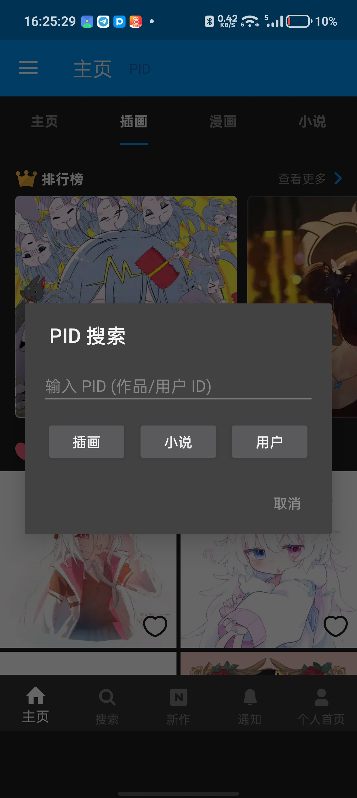

# PixivAdvanceSearch

适用于 [Pixiv](https://play.google.com/store/apps/details?id=jp.pxv.android) (jp.pxv.android) 的 LSPosed 模块。

> **注意**：本模块基于 Vibe Coding 开发，代码质量参差不齐，请谨慎使用。

### 功能

- **热门排序无限试用** — 热门度排序搜索的 7 天试用永不过期；高级版账号保留 Pixiv 原有逻辑，不受该 hook 影响。

- **PID 查询** — 主搜索页顶栏新增「PID」分段，进入独立 PID 搜索页。输入 PID 后点击一次「搜索」，会同时查询插画/漫画、小说、用户、漫画系列和小说系列，结果以卡片展示，点击卡片进入对应详情页。作品卡片显示预览图；用户卡片显示头像、账号、简介、作品数/小说数/关注数，高级版账号带 Premium 标记。搜索结果页不会添加 PID 分段。

- **封面特殊标签** — 在插画封面左下角显示 `R18`、`R18G`、`AI` 标签，方便快速识别。默认开启，可在模块设置中关闭。

- **R18/R18G 模糊** — 对 R18/R18G 的插画封面和作品详情预览图进行模糊处理，模糊半径可调（5–50dp，默认 24dp）。默认开启，可在模块设置中分别关闭封面模糊和详情模糊。Android 12 及以上使用 `RenderEffect` 实时模糊；Android 11 及以下使用降低透明度与深色滤镜兜底。

- **模块设置** — 侧边栏新增「模块设置」入口，打开模块自己的全屏 Compose Material 3 Expressive 设置页，包含「配置」和「关于」两个 Tab：
  - 可开关：封面特殊标签、封面模糊、详情预览模糊
  - 可调：模糊半径
  - 始终开启：PID 搜索、模块设置入口、作品详情弹窗、试用/AB 绕过

- **趋势标签长按** — 在搜索页长按趋势标签，弹出操作菜单：搜索该标签、跳转到示例作品、查看作品信息。普通点击仍保持原搜索行为。

- **M3E 弹窗** — 默认关闭。开启后把 Pixiv 自带的标题/正文/按钮提示框和列表菜单替换为 Material 3 Expressive 风格，列表菜单使用底部 Sheet。更改开关后需重启 Pixiv 生效；自定义 View、Spinner 和溢出菜单暂保持原生。

- **作品详情查看** — 长按作品 → 菜单新增「查看详情」。弹窗显示作品名称、作者名称、作品 PID、用户 PID，支持长按复制。

- **显示设置** — 侧边栏保留「显示设置」选项，点击打开网页版浏览与显示设置。

- **多语言** — 跟随 Pixiv 当前语言，内置 English / 简体中文 / 日本語。

### 截图

> 截图为早期版本，最新界面（模块设置页、PID 全类型搜索、封面标签/模糊）以实际安装为准。

 

### 工作原理

| 功能 | Hook 目标 | 搜索方式 |
|---|---|---|
| 试用天数 | `e9b.q()` | DexKit: `86400000L` 数字搜索（本地偏好键名不是 DEX 字符串） |
| AB 实验 | `m83.a()` | DexKit: 字符串 `"] cannot be converted to a boolean."` |
| PID 查询 | 主搜索页 `SegmentedLayout` 顶栏 | 直接类名 + DexKit fallback；Hook `setOnSelectSegmentListener`，追加第 4 个分段并注入 PID 页面 |
| 全类型 PID 搜索 | `app-api.pixiv.net` App API | 使用宿主 `AccountManager` 的 `net.pixiv` token 查询 illust/novel/user/series |
| 封面标签 / 封面模糊 | `ThumbnailView.d(ce7, boolean, Integer)`、排行榜 `d74.a()` | DexKit 定位 bind 方法与作品模型；字段读取失败时用 `toString` 兜底 |
| 详情预览模糊 | `DetailImageViewHolder.bind`、`DetailUgoiraViewHolder.bind` | 直接类名；读取作品模型 `xRestrict` 后对预览 View 应用模糊 |
| 趋势标签长按 | 搜索页趋势标签点击回调 | DexKit 用 `"TrendTag(tag="` / `"SearchIllustAtTrendTag"` 定位数据类与回调；Hook `AbstractComposeView` 判断长按 |
| M3E 弹窗 | `ne.create()` / `oe.show()` | DexKit 定位 `ne`/`je`/`oe`；`create()` 读取标题、正文、按钮和菜单项，`show()` 时替换为 Compose M3E 弹窗 |
| 模块设置 | `MainActivity` 侧边栏 | 查找 `NavigationView`，添加菜单项并打开 Compose 全屏 Dialog |
| 显示设置 | `MainActivity` 侧边栏 | 查找 `NavigationView`，添加菜单项并打开网页设置 |
| 查看详情 | 对话框 builder 的 `create()` | DexKit: `"layout_inflater"` → builder 参数类 → `addInvoke` → builder → `create()` |

可定位的类优先使用直接类名；混淆类优先使用 DexKit 字节码搜索，失败后回退到 6.205.0 的直接类名/字段。

### 构建

```bash
./gradlew assembleDebug
```

需要：

- `compileSdk 37.1` / `buildTools 37.0.0`
- AGP `9.5.3` / Gradle `9.8.2` / Kotlin `2.4.21`
- JDK 21
- Compose BOM `2026.11.01` / Material3 `1.5.0`

CI 使用 `assembleRelease` 构建，并直接上传未压缩的 APK。

### 安装

1. 安装 APK
2. 在 LSPosed 中启用模块，作用域选择 `jp.pxv.android`（或使用静态作用域）
3. 强制停止 Pixiv

### 支持版本

- Pixiv: 基于 **6.205.0** 开发与测试；混淆类/字段变化时依赖 DexKit 定位
- Android: **9.0+**（API 28+）；真正的 GPU 模糊需要 Android 12+（API 31+）
- LSPosed API: **102**

### 第三方开源

- [libxposed](https://github.com/libxposed/api) — Apache-2.0
- [DexKit](https://github.com/LuckyPray/DexKit) — Apache-2.0（`Core/` 目录为 LGPL-3.0）
- [AndroidHiddenApiBypass](https://github.com/LSPosed/AndroidHiddenApiBypass) — Apache-2.0
- AndroidX / Jetpack Compose / Material Components — Apache-2.0

完整声明见 [THIRD_PARTY_NOTICES.md](THIRD_PARTY_NOTICES.md)。

### 许可证

[Apache-2.0](LICENSE)
